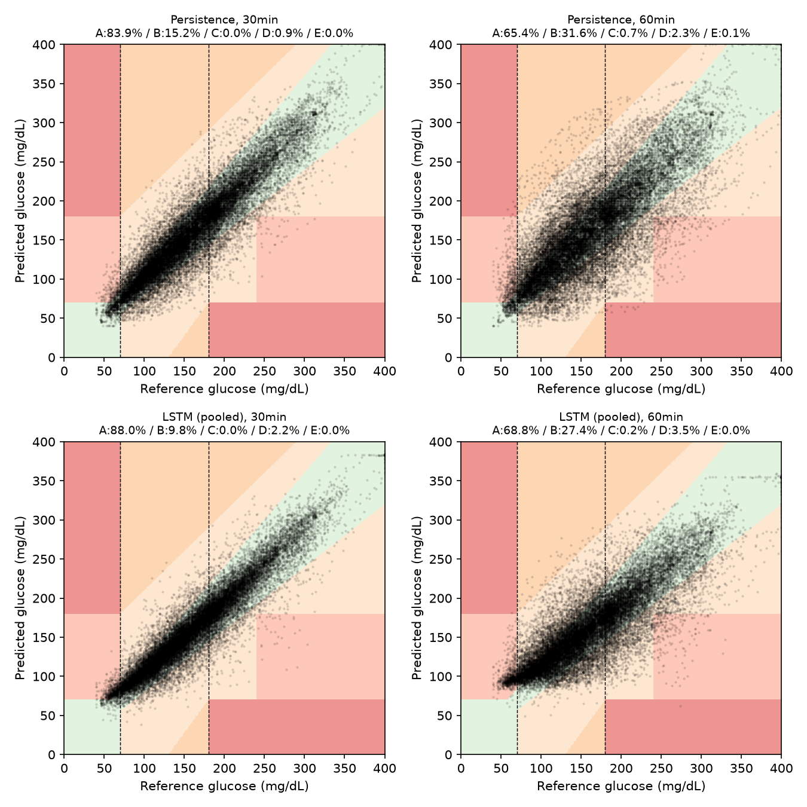

# Glucose Prediction (OhioT1DM)

[](https://github.com/MajedSalem/glucose_prediction/actions/workflows/tests.yml)

Blood-glucose forecasting for type 1 diabetes, benchmarking classical time-series
baselines against a deep sequence model, with a clinically framed evaluation.

## Goal

Predict continuous glucose monitor (CGM) readings 30 and 60 minutes ahead from
recent CGM history (optionally insulin and carbohydrate intake), and evaluate
predictions the way a clinician would: not just error magnitude, but whether
errors are safe (e.g. missed hypoglycemia is worse than a missed high).

This project favors a small, finished, honest comparison over a
state-of-the-art model.

## Data

- **[OhioT1DM](http://smarthealth.cs.ohio.edu/OhioT1DM-dataset.html)** — 12 real
  type 1 diabetes patients with CGM, insulin, carbohydrates, sleep, and heart
  rate. Requires a signed data-use agreement (DUA) with Ohio University.
  Raw data is **not** included in this repository — see [Data & privacy](#data--privacy).
- **[simglucose](https://github.com/jxx123/simglucose)** — an open-source
  Python UVA/Padova virtual-patient simulator. The original plan was to use
  it for synthetic data while the OhioT1DM data-use agreement was pending,
  but the real data arrived immediately, so this fallback was never needed —
  it remains a candidate for the closed-loop-controller stretch goal (see
  [What's next](#whats-next)).

## Task

From the last ~2 hours of CGM (optionally insulin and carbs), predict glucose
at +30 and +60 minutes. Data is resampled to a 5-minute grid; splits are by
patient and chronological, so there is no leakage.

## Methodology

- **Evaluation harness first**: RMSE and MAE at each horizon, time-in-range
  agreement, and a Clarke (or Parkes) error grid that scores clinical danger
  rather than raw error size.
- **Baselines**: persistence (glucose stays where it is), linear
  extrapolation, and one classical model (ARIMA or ridge regression on lagged
  features, and/or a Kalman filter).
- **Deep model**: an LSTM or GRU (optionally a small Transformer), trained
  pooled and/or per-patient, compared against the baselines on the exact same
  harness.
- **Error analysis**: where the model wins or loses relative to baselines —
  after meals, overnight, and around hypoglycemia — with the safety-critical
  case (missed lows) called out explicitly.

## Repository structure

```
glucose_prediction/
├── glucose_prediction/       # package
│   ├── config.py             # paths, horizons, sampling constants
│   ├── data/                 # OhioT1DM loader and windowing
│   ├── models/               # baselines and sequence models
│   └── evaluation/           # metrics, Clarke grid, regime slicing
├── scripts/                  # entry points (data build, training, evaluation, report)
├── docs/figures/             # committed report figures (Clarke grid, etc.)
├── notebooks/                # exploratory analysis
├── tests/
├── data/                     # gitignored; raw/processed data lives here locally
└── results/                  # gitignored; metrics tables (CSVs)
```

## Setup

```bash
python -m venv .venv
.venv/Scripts/activate      # Windows
source .venv/bin/activate   # macOS/Linux
pip install -r requirements.txt
```

Scripts are run as modules from the repository root, in this order:

```bash
python -m scripts.build_ohio_dataset      # parse raw OhioT1DM XML into 5-minute-grid CSVs
python -m scripts.run_baselines           # persistence, linear extrapolation, ridge
python -m scripts.run_sequence_model      # pooled LSTM
python -m scripts.run_error_analysis      # regime / hypoglycemia breakdown
python -m scripts.generate_report         # results tables + Clarke-grid figure
```

## Data & privacy

OhioT1DM is distributed under a data-use agreement. This repository never
commits raw patient data — only code and aggregate, de-identified results.
`data/raw/` and `data/processed/` are gitignored.

## Results

Baselines and the LSTM are evaluated on each patient's own held-out,
chronologically later test split, through one evaluation harness
(`glucose_prediction/evaluation/harness.py`). All four predictors use CGM
history only (24 lagged 5-minute glucose readings, no insulin/carbs), for a
fair, apples-to-apples comparison.

RMSE / MAE (mg/dL), mean ± std across the 12 patients:

| Horizon | Persistence | Linear extrapolation | Ridge | LSTM (pooled) |
|---|---|---|---|---|
| RMSE, 30min | 23.18 ± 2.83 | 38.08 ± 5.65 | 19.85 ± 2.30 | **19.37 ± 2.17** |
| RMSE, 60min | 37.99 ± 4.62 | 59.23 ± 8.61 | 33.56 ± 3.82 | **32.74 ± 3.55** |
| MAE, 30min | 16.78 ± 1.99 | 27.42 ± 3.83 | 14.24 ± 1.54 | **13.89 ± 1.58** |
| MAE, 60min | 28.13 ± 3.36 | 43.26 ± 6.26 | 25.25 ± 3.04 | **24.58 ± 2.82** |

Ridge beats the persistence baseline at every one of the 12 patients, both
horizons. Linear extrapolation is honestly *worse* than persistence
everywhere — a per-window least-squares slope amplifies CGM sensor noise
into an overshooting trend, a real and well-documented effect for this kind
of data. The pooled LSTM beats ridge, but modestly (~2–3%, confirmed stable
across 3 random seeds) and not on every patient (it wins 21 of 24
patient×horizon pairs).

### Does it miss lows? (the headline finding)

Average error alone hides the result that matters clinically. Restricted to
the ~2.8% of test windows where the true glucose was actually below
70 mg/dL (hypoglycemia):

| Model | Horizon | Hit rate (Zone A) | Missed → normal (Zone D) | Missed → high (Zone E) |
|---|---|---|---|---|
| Persistence | 30min | **71.75%** | 28.25% | 0.00% |
| Linear extrapolation | 30min | 82.09% | 17.65% | 0.25% |
| Ridge | 30min | 57.76% | 42.24% | 0.00% |
| LSTM (pooled) | 30min | 25.98% | 74.02% | 0.00% |
| Persistence | 60min | **47.11%** | 51.88% | 1.01% |
| Linear extrapolation | 60min | 73.49% | 21.98% | 4.52% |
| Ridge | 60min | 7.66% | 92.21% | 0.13% |
| LSTM (pooled) | 60min | 0.63% | 99.25% | 0.13% |

**The model with the best average RMSE is the worst at catching a real low,
and this gets worse — not better — at the longer horizon.** The LSTM's
hypoglycemia hit rate collapses from 26% at 30 minutes to 0.6% at 60
minutes, while the "dumb" persistence baseline catches 72%/47%. This is a
textbook regression-to-the-mean effect: hypoglycemia is only ~2.8% of
training windows, so a fitted model — more so the higher-capacity LSTM than
linear ridge — minimizes overall error by systematically under-predicting
how deep real lows go, at the direct cost of ever crossing the 70 mg/dL
line. Reassuringly, the most dangerous failure mode (Zone E — predicting
*high* when truly low) stays rare throughout (0–4.5%); the dominant risk is
Zone D, silently calling a real low "normal." **The naive persistence
baseline is the most clinically sensitive hypo detector of all four
predictors tested** — exactly the kind of unflattering-to-the-fancy-model
result this evaluation is designed to surface, not hide.

### Clarke Error Grid



Reference (true) vs. predicted glucose, pooled across all 12 patients' test
windows, colored by Clarke Error Grid zone (Clarke et al., 1987) — A/B are
clinically acceptable, C/D/E are progressively more dangerous. Dashed lines
mark the 70 and 180 mg/dL hypo/hyper thresholds. The bottom-left quadrant
(true glucose < 70) is where the hit-rate collapse above is visible: LSTM
predictions in that corner sit further from the diagonal than persistence's,
especially at 60 minutes.

### By clinical regime

RMSE (mg/dL), pooled across all 12 patients' test windows:

| Horizon | Regime (n) | Persistence | Linear extrap. | Ridge | LSTM (pooled) |
|---|---|---|---|---|---|
| 30min | Postprandial (7086) | 28.09 | 42.87 | 24.23 | **23.61** |
| 30min | Overnight (7507) | 15.39 | 23.32 | 14.39 | **13.92** |
| 30min | Hypoglycemia (793) | 16.69 | 31.92 | 16.42 | 20.58 |
| 60min | Postprandial (7016) | 44.51 | 63.24 | 39.51 | **38.81** |
| 60min | Overnight (7457) | 25.67 | 37.52 | 25.35 | **24.17** |
| 60min | Hypoglycemia (796) | 35.29 | 56.27 | 37.69 | 41.34 |

The LSTM's RMSE edge over ridge holds up in both the postprandial and
overnight regimes — it's not a one-subset fluke. It only reverses in the
hypoglycemia regime, consistent with the finding above.

Full per-patient tables and additional verification detail are in
[`progress.md`](progress.md). Reproduce all of the above with
`python -m scripts.generate_report` (see [Setup](#setup)).

## Limitations

- **Glucose history only**: baselines and the LSTM use CGM lag features
  only, no insulin/carbs — a deliberate scope choice to keep the comparison
  apples-to-apples; see [What's next](#whats-next).
- **The LSTM's win over ridge is real but narrow and not universal
  per-patient** (see above) — reported as-is, not rounded up to "the LSTM
  wins."
- **The LSTM (and to a lesser extent ridge) is meaningfully worse than
  naive persistence at detecting real hypoglycemia**, despite having the
  best average RMSE — a regression-to-the-mean effect from hypoglycemia
  being ~2.8% of training data. A hypo-weighted loss would directly target
  this (see [What's next](#whats-next)).
- **Clarke Error Grid only** — the Parkes/Consensus grid (different,
  diabetes-type-specific boundaries, no Zone E) was considered and
  deliberately left out, to keep scope to one well-precedented grid.
- **CGM gaps are marked, not imputed** — a window touching a gap is dropped
  entirely rather than interpolated.
- A "dual" bolus's true two-component (immediate + extended) insulin
  delivery profile isn't recoverable from this dataset's schema; modeled as
  one uniform-rate delivery. Only affects the unused `insulin_u` column.
- Ridge uses default `alpha=1.0`; the LSTM's hidden size (32) was chosen
  from a 3-point sweep (16/32/64) that landed within noise of each other —
  no broader hyperparameter search on either, appropriate for a "keep it
  modest" first pass.
- The pooled LSTM uses one global normalization and one pooled
  validation-RMSE early-stopping criterion across all 12 patients, not
  per-patient.
- Regime definitions (120-minute postprandial lookback, hours 0–6 as
  "overnight") are one reasonable, data-justified choice each, not the only
  valid one.

## What's next

- Add insulin and carbohydrate intake as model inputs.
- A hypo-weighted loss, to directly target the safety-critical finding
  above.
- Per-patient fine-tuning or normalization on top of the pooled LSTM.
- A Kalman filter + LSTM hybrid.
- A simple controller evaluated in
  [simglucose](https://github.com/jxx123/simglucose), closing the loop from
  prediction to an insulin-dosing decision.

## Status

Complete: data pipeline, evaluation harness, three baselines, a pooled
LSTM, clinical-regime error analysis, and this results/limitations writeup
are all built, tested, and reported above.

## Citation

This project uses the OhioT1DM Dataset. If you build on this work, please
cite the dataset itself (per the dataset authors' own request):

> Marling, C., & Bunescu, R. (2020). The OhioT1DM Dataset for Blood Glucose
> Level Prediction: Update 2020. *CEUR Workshop Proceedings*, 2675, 71–74.

```bibtex
@article{marling2020ohiot1dm,
  title   = {The OhioT1DM Dataset for Blood Glucose Level Prediction: Update 2020},
  author  = {Marling, Cindy and Bunescu, Razvan},
  journal = {CEUR Workshop Proceedings},
  volume  = {2675},
  pages   = {71--74},
  year    = {2020}
}
```

## License

MIT — see [LICENSE](LICENSE).
